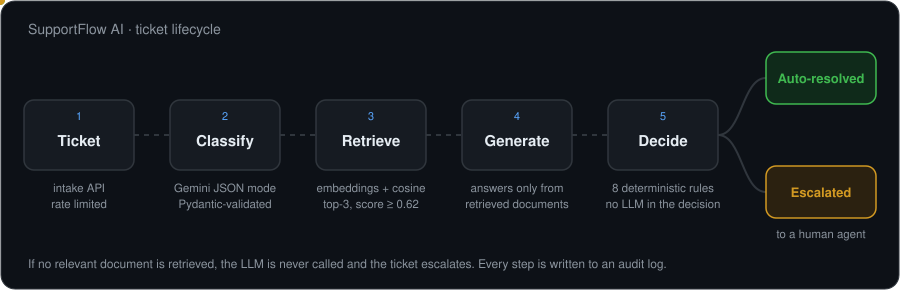
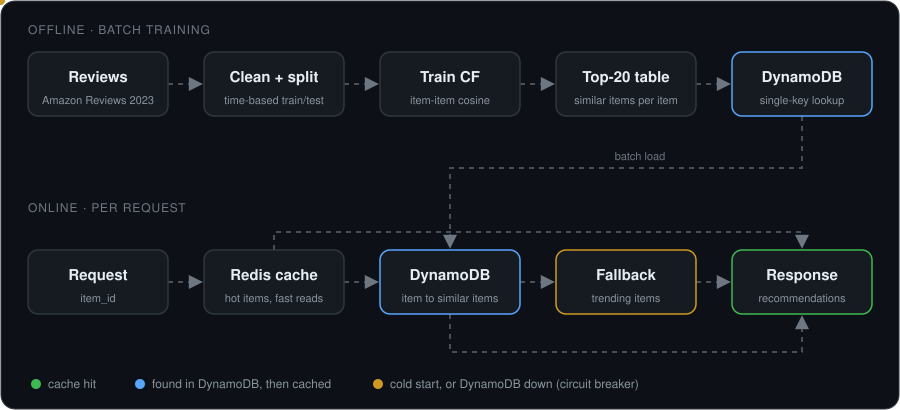
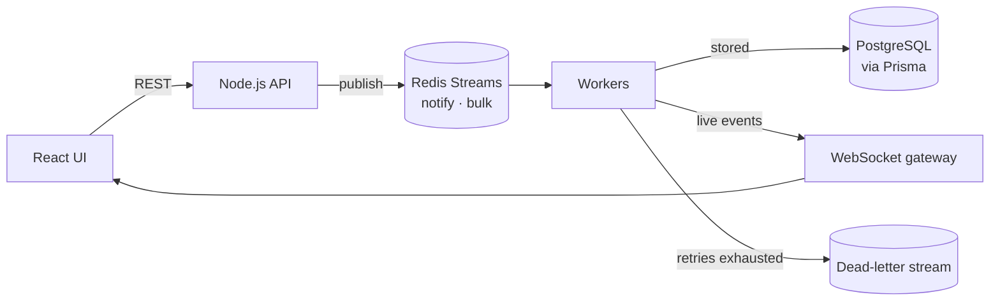

[**Projects**](#featured-projects) &nbsp;·&nbsp; [**Skills**](#skills) &nbsp;·&nbsp; [**Competitive programming**](#competitive-programming) &nbsp;·&nbsp; [**Contact**](#contact)

## About

2026 B.Tech CSE graduate (BIET Jhansi). I build **Python/FastAPI backends and RAG-based LLM applications**, and I care most about the parts demos usually skip: retries, fallbacks, guardrails, tests, and measuring what the system actually does.

- **Latest:** [SupportFlow AI](https://github.com/A-yushupadhyay/supportflow-ai), a live RAG support-ticket platform where the LLM recommends and tested rules decide.
- **Experience:** Full-stack intern at Uptricks Services (Jul to Sep 2025): REST APIs, JWT/RBAC auth, CI/CD with GitHub Actions.
- **Looking for:** SDE-1, backend and GenAI engineer roles. Based in Noida, open to relocation.

## Featured projects

| Project | What it is | Live | Source |
|---|---|---|---|
| **SupportFlow AI** | RAG support-ticket automation with human-in-the-loop escalation | [Demo](https://supportflow-ai-theta.vercel.app/) · [API docs](https://supportflow-ai-rg3g.onrender.com/docs) | [Code](https://github.com/A-yushupadhyay/supportflow-ai) |
| **LLM Evaluation Platform** | Compare prompts and models on similarity, latency and cost | Run locally (Docker Compose) | [Code](https://github.com/A-yushupadhyay/LLM-Evalution-Plateform) |
| **Recommendation Engine** | Item-item collaborative filtering with a load-tested serving layer | Run locally | [Code](https://github.com/A-yushupadhyay/amazon-recommendation-engine) |
| **Notify Service** | Async notification pipeline on Redis Streams with retries and a DLQ | Run locally | [Code](https://github.com/A-yushupadhyay/Notify-Service) |

More: [FinSphere](https://github.com/A-yushupadhyay/Finsphere) (Next.js banking app, [demo](https://finsphere-gamma.vercel.app/)) · [WorkNest](https://github.com/A-yushupadhyay/Worknest) (MERN task manager, [demo](https://worknest-delta.vercel.app/))

> The SupportFlow backend runs on a free tier and sleeps when idle, so the first request can take about a minute.

---

### SupportFlow AI

- **Problem:** support teams re-answer the same questions, but billing disputes and outages must not be answered by a model guessing.
- **What I built:** a pipeline that classifies each ticket (Gemini JSON mode, temperature 0, Pydantic-validated output), retrieves knowledge by embedding similarity, drafts a grounded reply, and routes it. Agents get a review panel and an audit log of every step.
- **Key decision:** the LLM never decides. Eight unit-tested rules (priority, sensitive keywords, grounding, cited-source check, confidence) choose between auto-resolve and escalation. If retrieval finds nothing relevant, the model is not called at all.
- **Engineering:** AI calls sit behind an `AIProvider` interface (Gemini plus a mock for tests), with timeouts, retries and rate limiting. 43 backend tests, GitHub Actions CI, deployed on Vercel, Render and Neon.
- **Honest limits:** confidence scores are self-reported by the model, the retrieval threshold was tuned on a handful of sample queries rather than an evaluation set, and retrieval is a linear scan over embeddings stored as JSON (`pgvector` is the next step).

**Stack:** Python, FastAPI, Next.js, TypeScript, PostgreSQL, Gemini API, Docker, GitHub Actions

---

### LLM Evaluation Platform

- **Problem:** choosing a prompt or model by eye does not scale or repeat.
- **What I built:** multi-prompt, multi-model experiments queued in Redis and run by an async worker. Each output is scored by semantic similarity (sentence-transformers `all-MiniLM-L6-v2`), with per-call latency and token-based cost tracked and a leaderboard on top.
- **Key decision:** a `BaseLLM` abstraction plus a mock mode, so the whole pipeline runs and tests without spending API credits.
- **Honest limits:** similarity to a reference answer is a proxy for quality, not a hallucination or correctness check.

**Stack:** Python, FastAPI, React (Vite), PostgreSQL, Redis, Docker Compose

---

### Recommendation Engine

- **Problem:** build the full path from model to serving, not just a notebook.
- **What I built:** item-item collaborative filtering evaluated on a time-split holdout. Precision@10 is 0.0295 against 0.0263 for a popularity baseline, a **+12.2% relative** lift. Served through FastAPI with DynamoDB and Redis caching.
- **Key decision:** failures were tested by stopping Redis and DynamoDB mid-run. A circuit breaker falls back to trending items. A load test exposed a thread-pool problem that pushed p99 latency to about 4.8 s, and fixing it brought p99 to about 30 ms at 63.6 req/s with 0 failures.
- **Honest limits:** the A/B test is a simulation and its CTR lift was not statistically significant (p = 0.858), which the write-up says outright.

**Stack:** Python, FastAPI, pandas, scikit-learn, SciPy, DynamoDB, Redis, PostgreSQL, Locust

---

### Notify Service

- **Problem:** most notification demos stop at "send an email"; the interesting part is behaviour under failure.
- **What I built:** a pipeline where events go through Redis Streams to workers, with retries, a dead-letter queue, scheduling, bulk fan-out, and a live UI that shows what the system is doing.

**Stack:** Node.js, Redis Streams, PostgreSQL, Prisma, WebSockets, React, Docker

---

## Skills

Only technologies I have shipped in a project above or on my [repositories](https://github.com/A-yushupadhyay?tab=repositories).

| Area | Tools |
|---|---|
| **Languages** | Python, TypeScript, JavaScript, C++, SQL |
| **Backend and APIs** | FastAPI, Node.js, Express, REST, Pydantic, SQLAlchemy, Prisma, JWT auth, WebSockets / Socket.IO |
| **Frontend** | React, Next.js, Tailwind CSS |
| **Data and messaging** | PostgreSQL, Redis (caching, queues, Streams), MongoDB, DynamoDB |
| **AI and data** | RAG, Gemini API, OpenAI API, sentence-transformers, pandas, scikit-learn, SciPy |
| **DevOps and tools** | Docker, Docker Compose, GitHub Actions, Git, Vercel, Render, AWS (DynamoDB) |

Familiar from coursework, not yet used in a project: LangChain, NLP and text mining.

## Competitive programming

| Platform | Result |
|---|---|
| [Codeforces](https://codeforces.com/profile/puskaru2003) | Specialist, max rating 1478 |
| LeetCode | Rating 1800+ |
| [CodeChef](https://www.codechef.com/users/ayus124) | 4-star |

800+ problems solved, mostly in C++ (graphs, DP, trees).

## Activity

<picture>
  <source media="(prefers-color-scheme: dark)" srcset="https://raw.githubusercontent.com/A-yushupadhyay/A-yushupadhyay/output/github-snake-dark.svg" />
  <source media="(prefers-color-scheme: light)" srcset="https://raw.githubusercontent.com/A-yushupadhyay/A-yushupadhyay/output/github-snake.svg" />
  
</picture>

## Contact

[LinkedIn](https://linkedin.com/in/ayush-upadhyay-230015266) · [Portfolio](https://portfolio-ayush-upadhyay.vercel.app) · [Email](mailto:puskaru202@gmail.com)
